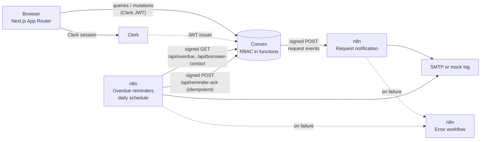
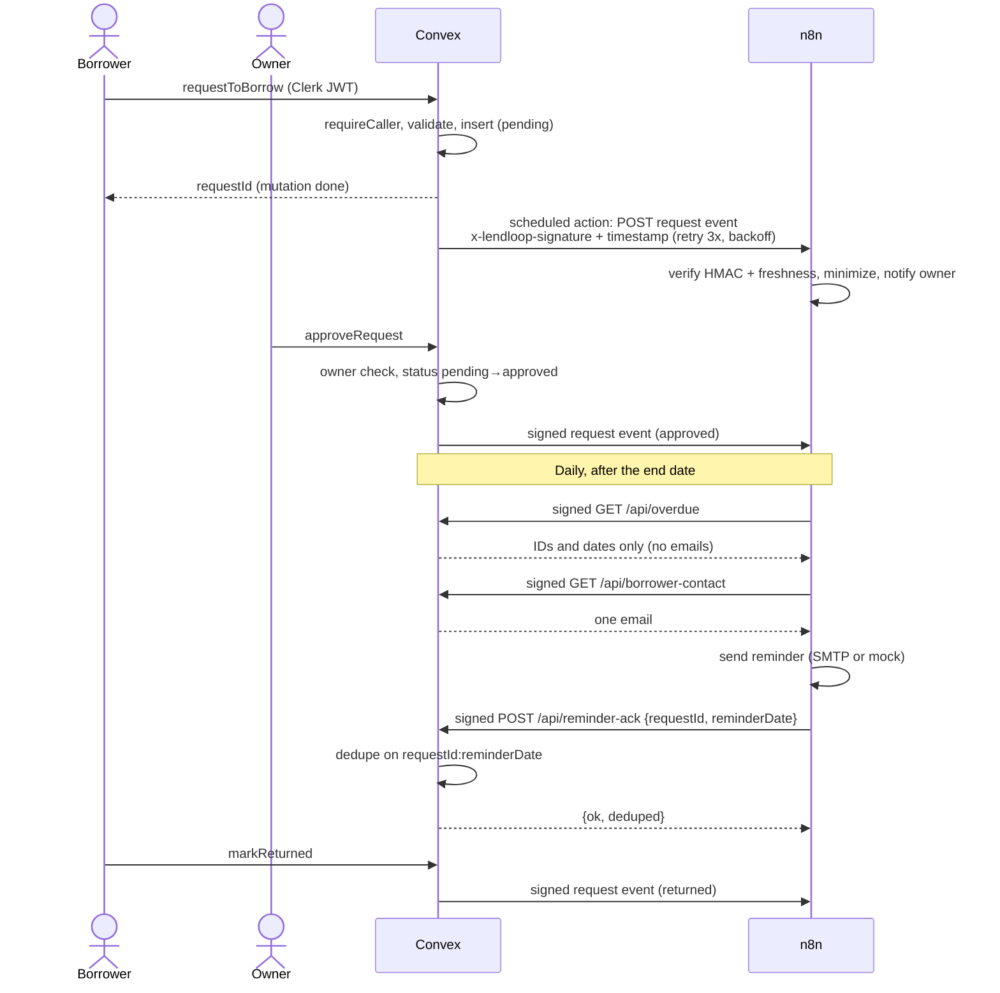

# LendLoop

LendLoop is a neighborhood tool-lending board: **"Borrow what you need. Lend what you don't."**

Stack: **Next.js (App Router) + TypeScript**, **Clerk** (auth), **Convex** (data + backend logic), **n8n** self-hosted via docker-compose (automation).

## Local setup

### 1. Prerequisites

- Node.js 20+
- A [Clerk](https://clerk.com) application (publishable + secret key)
- A [Convex](https://convex.dev) project (`npx convex dev` login)
- Docker (for n8n)

### 2. App

```bash
npm install
cp .env.example .env   # then fill in keys (see Environment variables)
npx convex dev         # generates convex/_generated, syncs schema
npm run dev            # http://localhost:3000
```

> `convex/_generated/` is checked in as a placeholder so the repo typechecks
> standalone. Running `npx convex dev` replaces it with the real codegen.

Clerk ↔ Convex trust (required, otherwise sign-in hangs at "Setting up your
account"):

1. Clerk dashboard → **Configure → JWT templates** → **New template** →
   **Convex**. Keep the name `convex`.
2. Clerk dashboard → **Configure → API keys** → copy the **Frontend API URL**
   (e.g. `https://xxx.clerk.accounts.dev`).
3. Convex dashboard → your project → **Settings → Environment Variables** →
   add `CLERK_JWT_ISSUER_DOMAIN` with that URL. Also add `WEBHOOK_HMAC_SECRET`
   (same value as the app's `.env`), and `N8N_REQUEST_WEBHOOK_URL`
   (the n8n production webhook URL, e.g.
   `https://<your-n8n-host>/webhook/lendloop/request-event`). If it is unset,
   request events are skipped and the app works normally. Convex must be able
   to reach n8n, so for local n8n use a tunnel (e.g. `cloudflared` or `ngrok`).
4. Restart `npx convex dev` so it picks up `convex/auth.config.ts`.

### 3. n8n (self-hosted)

```bash
# Required in your shell (or a local .env file, never committed):
export N8N_ENCRYPTION_KEY="$(openssl rand -hex 32)"
export WEBHOOK_HMAC_SECRET="$(node -e "console.log(require('crypto').randomBytes(32).toString('hex'))")"
# Must match WEBHOOK_HMAC_SECRET in the app's .env (Convex env settings).
# Optional SMTP (otherwise n8n logs a mock): SMTP_HOST/PORT/USER/PASS/FROM.
# The overdue workflow also needs the Convex HTTP deployment URL:
export CONVEX_HTTP_URL="https://<your-deployment>.convex.site"

docker compose up -d   # n8n at http://localhost:5678
```

Then in the n8n UI: import `n8n/workflows/request-notification.json`,
`n8n/workflows/overdue-reminders.json`, and `n8n/workflows/error-workflow.json`
**exactly once each** (re-importing creates duplicates that fight over the same
webhook path); create the **LendLoop SMTP** credential (only if sending real
email); activate the workflows. Set each workflow's **Settings → Error
Workflow** to `LendLoop — Error workflow` (the JSON stores a placeholder —
error routing needs the live workflow ID, so this is a UI step).

> `docker-compose.yml` already sets `N8N_BLOCK_ENV_ACCESS_IN_NODE=false` and
> `NODE_FUNCTION_ALLOW_BUILTIN=crypto` — both are required for the HMAC Code
> nodes. Without SMTP env vars the workflows mock-log instead of emailing.

### 4. First admin

1. In the Clerk dashboard, set the user's `publicMetadata` to `{ "role": "admin" }`.
2. Sign in once — `ensureUser` mirrors the role into the Convex `users` table.
3. All subsequent checks read the server-side row; client-sent roles are ignored.

## Environment variables

See `.env.example`. Rules:

- `NEXT_PUBLIC_*` = safe to expose (Clerk publishable key, Convex URL).
- Everything else is server-side only — notably `CLERK_SECRET_KEY` and
  `WEBHOOK_HMAC_SECRET`.
- n8n secrets live in n8n credentials / container env, never in code or the
  exported workflow JSON (workflows reference `$env.*` only).

## Architecture

### System overview



### Request lifecycle



- **Data model:** `users` (clerkId, role, trustedLender), `tools`
  (owner, name, category, condition, description, available), `requests`
  (tool, borrower, start/end dates, status machine
  `pending → approved → returned`, plus `declined`/`cancelled`; `overdue` is
  *derived*, never client-set), `reminders` (request, reminder date, sent-at,
  channel — also rendered as "automation activity" on each loan).
- **Convex → n8n:** on request create/approve/decline/return/cancel the
  mutation schedules `internal.notify.sendRequestEvent`
  (`ctx.scheduler.runAfter(0, …)`), which runs after the mutation commits.
  It signs a minimal payload (`requestId, toolName, status, startDate,
  endDate, borrowerId`) and POSTs it to `N8N_REQUEST_WEBHOOK_URL`, with 3
  attempts and exponential backoff (500 ms, 1 s). n8n being down never blocks
  or fails the user's action; failures are logged in Convex.
- **n8n → Convex:** daily schedule fetches `/api/overdue`, resolves borrower
  contact per borrower at send time, sends via SMTP (or mock-logs), and writes
  back to `/api/reminder-ack` with an idempotency key (`requestId:reminderDate`).

## Security and data-minimization decisions

Full threat model, data-flow table and residual risks: [SECURITY.md](SECURITY.md).


- **HMAC-SHA256 both directions** (`convex/webhooks.ts`, mirrored in n8n Code
  nodes): `sha256` signature header + unix-timestamp header over
  `${timestamp}.${rawBody}`; constant-time compare; ±5 min freshness window.
- **RBAC in Convex functions, not the UI:** every query/mutation resolves the
  caller from `ctx.auth` → server-side `users` row. Users act only on their own
  listings/requests; admin-only ops (`adminRemoveListing`, `allRequests`,
  `setTrustedLender`) require `role === "admin"`.
- **Data minimization:** public page shows tool name + category only (no owner
  details); webhook payloads carry IDs + minimum fields; the overdue list
  carries no emails — n8n resolves contact per borrower at send time.
- **Idempotency:** reminder write-backs keyed by `requestId:reminderDate`;
  retries return `{ deduped: true }` and never duplicate rows or reminders.
- **Reliability:** retries on all n8n HTTP nodes (3–5 tries) plus an Error
  Workflow so failures are visible, never silent.

## Tests

```bash
npx vitest run   # HMAC sign/verify (valid, tampered, stale), idempotency keys,
                 # overdue derivation, status-machine transition table,
                 # request-event payload + retry/backoff, and the exported n8n
                 # "Verify HMAC" node run against the app's signed output
npm run build    # production build + typecheck
```

## Docs

- `PRODUCTION.md` — what changes for production.
- `SECURITY.md` — threat model, mitigations and residual risks.
- `LendLoop_build_brief.md` — the original build brief.
