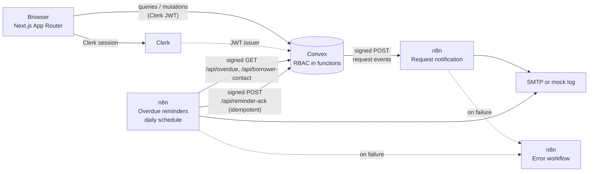

# LendLoop

**Borrow what you need. Lend what you don't.**

LendLoop is a neighborhood tool-lending board. Anyone can browse available
tools; signed-in users list their own tools, request to borrow others for a
date range, approve or decline incoming requests and mark loans as returned.
Admins can remove any listing, view all loans and mark lenders as Trusted.
Two n8n workflows handle request notifications and daily overdue reminders.

**Stack:** Next.js (App Router) and TypeScript, Clerk for auth, Convex for
data and backend logic, n8n self-hosted with docker-compose.

## Highlights

- **Roles enforced server-side in Convex.** Every query and mutation resolves
  the caller from the Clerk identity to a server-side `users` row. Users act
  only on their own listings and loans; admin operations check
  `role === "admin"`. Client-sent roles are never trusted.
- **Signed webhooks in both directions.** HMAC-SHA256 over
  `timestamp.body`, constant-time comparison and a 5 minute freshness window,
  used by Convex and mirrored in the n8n Code nodes.
- **Reliable automation.** Request events are sent after the mutation
  commits, with 3 attempts and backoff, so n8n being down never blocks a user.
  Reminder write-backs are idempotent (`requestId:reminderDate`). n8n HTTP
  nodes retry and failures go to an error workflow.
- **Data minimization.** The public page shows tool name and category only.
  n8n receives IDs, tool name, dates and status, never emails in bulk; it
  looks up one borrower email at send time.
- **Audit log.** Listing create/delete, admin removals, trusted-lender
  changes and every request transition are recorded (actor ID, action,
  target ID, time) and shown to admins.
- **Rate limits.** Per-user limits on listing creation (10/hour) and borrow
  requests (20/hour), enforced inside Convex mutations.
- **23 tests** (Vitest), including one that runs the exported n8n
  "Verify HMAC" node against the app's signed output.

Docs: [SECURITY.md](SECURITY.md) (threat model, data flows, residual risks)
and [PRODUCTION.md](PRODUCTION.md) (what changes for production).

## Local setup

### 1. Prerequisites

- Node.js 20+
- A [Clerk](https://clerk.com) application
- A [Convex](https://convex.dev) project
- Docker (for n8n)

### 2. App

```bash
npm install
cp .env.example .env   # fill in keys (see Environment variables)
npx convex dev         # syncs schema and functions, regenerates convex/_generated
npm run dev            # http://localhost:3000
```

`convex/_generated/` is committed so the repo typechecks without a Convex
login; `npx convex dev` regenerates it.

Connect Clerk and Convex:

1. Clerk dashboard: **Configure > JWT templates > New template > Convex**.
   Keep the name `convex`.
2. Clerk dashboard: **Configure > API keys**, copy the **Frontend API URL**
   (e.g. `https://xxx.clerk.accounts.dev`).
3. Convex dashboard: **Settings > Environment Variables**, add:
   - `CLERK_JWT_ISSUER_DOMAIN`: the Frontend API URL above
   - `WEBHOOK_HMAC_SECRET`: shared secret, same value as in n8n
   - `N8N_REQUEST_WEBHOOK_URL` (optional): the n8n webhook URL, e.g.
     `https://<your-n8n-host>/webhook/lendloop/request-event`
4. Restart `npx convex dev` so it picks up `convex/auth.config.ts`.

**Note on the request webhook:** Convex runs in the cloud, so it can only
call an n8n instance with a public URL. For n8n on localhost, expose it with
a tunnel (e.g. `cloudflared` or `ngrok`) and use that URL. If
`N8N_REQUEST_WEBHOOK_URL` is unset, request events are skipped and the app
works normally.

### 3. n8n

```bash
export N8N_ENCRYPTION_KEY="$(openssl rand -hex 32)"
export WEBHOOK_HMAC_SECRET="<same value as in Convex>"
export CONVEX_HTTP_URL="https://<your-deployment>.convex.site"
# Optional SMTP (otherwise notifications are mock-logged):
# SMTP_HOST, SMTP_PORT, SMTP_USER, SMTP_PASS, SMTP_FROM

docker compose up -d   # n8n at http://localhost:5678
```

In the n8n UI, import each file in `n8n/workflows/` once
(`request-notification.json`, `overdue-reminders.json`,
`error-workflow.json`) and activate them. Then set each workflow's
**Settings > Error Workflow** to `LendLoop - Error workflow`; the exported
JSON cannot hold the live workflow ID, so this is set in the UI.

`docker-compose.yml` sets `N8N_BLOCK_ENV_ACCESS_IN_NODE=false` and
`NODE_FUNCTION_ALLOW_BUILTIN=crypto`, which the HMAC Code nodes need.

### 4. First admin

1. In the Clerk dashboard, set the user's `publicMetadata` to
   `{ "role": "admin" }`.
2. Sign in once; `ensureUser` copies the role into the Convex `users` table.
3. From then on, all checks read the server-side row.

## Environment variables

All variables are listed in `.env.example`.

- `NEXT_PUBLIC_*` are safe to expose (Clerk publishable key, Convex URL).
- Everything else is server-side only, notably `CLERK_SECRET_KEY` and
  `WEBHOOK_HMAC_SECRET`.
- n8n reads secrets from its container environment (`$env.*`); none are in
  code or in the exported workflow JSON.

## Architecture

### System overview



### Request lifecycle


- **Data model:** `users` (clerkId, role, trustedLender), `tools`
  (owner, name, category, condition, description, available), `requests`
  (tool, borrower, start/end dates, status machine
  `pending > approved > returned`, plus `declined`/`cancelled`; `overdue` is
  *derived*, never client-set), `reminders` (request, reminder date, sent-at,
  channel and also rendered as "automation activity" on each loan),
  `rateLimits` (per user + action window counters), `auditLog` (actor,
  action, target, time).
- **Convex to n8n:** on request create/approve/decline/return/cancel the
  mutation schedules `internal.notify.sendRequestEvent`
  (`ctx.scheduler.runAfter(0, ...)`), which runs after the mutation commits.
  It signs a minimal payload (`requestId, toolName, status, startDate,
  endDate, borrowerId`) and POSTs it to `N8N_REQUEST_WEBHOOK_URL`, with 3
  attempts and exponential backoff (500 ms, 1 s). n8n being down never blocks
  or fails the user's action; failures are logged in Convex.
- **n8n to Convex:** daily schedule fetches `/api/overdue`, resolves borrower
  contact per borrower at send time, sends via SMTP (or mock-logs), and writes
  back to `/api/reminder-ack` with an idempotency key (`requestId:reminderDate`).

## Security and data minimization

Summary below; full threat model, data-flow table and residual risks are in
[SECURITY.md](SECURITY.md).

- **HMAC-SHA256 both directions** (`convex/webhooks.ts`, mirrored in the n8n
  Code nodes): `x-lendloop-signature: sha256=<hex>` and
  `x-lendloop-timestamp` headers over `${timestamp}.${rawBody}`;
  constant-time compare; 5 minute freshness window.
- **Authorization in Convex functions, not the UI** (`convex/helpers.ts`,
  `convex/tools.ts`, `convex/requests.ts`, `convex/users.ts`).
- **Data minimization:** public list returns name and category only; request
  events carry six fields; the overdue list carries no emails.
- **Idempotency:** reminder write-backs keyed by `requestId:reminderDate`
  return `{ deduped: true }` on retry.
- **Reliability:** n8n HTTP nodes retry (3 to 5 tries) and route failures to
  the error workflow.
- **Rate limits and audit log:** `convex/limits.ts`; admins see the audit
  log in the Admin panel.

## Tests

```bash
npx vitest run       # 23 tests
npx tsc --noEmit     # typecheck
npx eslint .         # lint
```

Coverage: HMAC sign/verify (valid, tampered, stale), constant-time compare,
idempotency keys, overdue derivation and status transitions, request-event
payload fields, retry and backoff, the exported n8n "Verify HMAC" node
accepting the app's signature and rejecting a tampered body, and the rate
limiter.

## Project layout

```
app/                 Next.js pages and UI
components/ui.tsx    UI primitives
convex/              schema, queries/mutations, HTTP endpoints, webhook signing,
                     rate limits and audit log
n8n/workflows/       exported n8n workflows
tests/               Vitest tests
docker-compose.yml   self-hosted n8n
```
